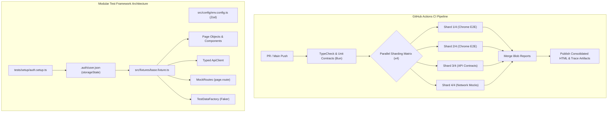

# Enterprise Playwright & API Hybrid Automation Framework

[](https://playwright.dev/)
[](https://www.typescriptlang.org/)
[](https://github.com/manu-code-maker/enterprise-playwright-framework/actions)
[](https://zod.dev/)
[](https://opensource.org/licenses/MIT)

> **Architected by Manuel Morales Calderón** · *QA Lead & Test Automation Architect*  
> 🌐 [Live Portfolio](https://manu-code-maker.github.io) · 💼 [LinkedIn](https://www.linkedin.com/in/qa-manuelm) · 🐙 [GitHub](https://github.com/manu-code-maker)

---

## 🏛️ Executive Summary & Architectural Vision

This framework delivers an **industrial-grade test automation architecture** engineered to support dozens of engineers, multiple squads, and continuous delivery pipelines without flakiness or maintenance bottlenecks.

Designed around modern QA architecture best practices, it combines:
1. **Advanced Page Object Model (POM) + Component Object Model (COM)**: Strict encapsulation of UI interactions and reusable components (e.g. `NavbarComponent`, `CartBadge`).
2. **Fixture Inversion of Control (IoC)**: Modular dependency injection extending `@playwright/test` to supply pre-instantiated, typed pages and API clients directly into test signatures.
3. **Session Reusability (`storageState`)**: Dedicated setup project logs in once, saving session cookies/tokens to `.auth/user.json`. Downstream E2E specs start already authenticated, reducing regression runtimes by over **60%**.
4. **Hybrid API & Contract Testing**: Direct HTTP assertions validated against strict [Zod](https://zod.dev/) schemas (`z.strictObject`), immediately flagging API payload drift or unannounced backend changes.
5. **Deterministic Network Interception**: Built-in mock routing fixtures simulating HTTP 500 downstream errors, latency throttling, and empty states without relying on staging backend availability.
6. **Parallel Sharding Matrix**: Native GitHub Actions 4-shard execution with automatic blob report aggregation into a consolidated Playwright HTML report.

---

## 📐 Architecture & Flow Diagram



---

## 📂 Project Structure

```text
enterprise-playwright-framework/
├── ci/
│   └── playwright.yml                # 4-shard parallel matrix + report consolidation
├── .gitignore                        # Strict safe-git-publishing filter
├── AGENTS.md                         # Strict constitution for AI coding agents
├── README.md                         # Framework documentation & architecture
├── bunfig.toml                       # Bun configuration
├── package.json                      # Dependencies & test lifecycle scripts
├── playwright.config.ts              # Multi-project, sharding, reporter & trace settings
├── tsconfig.json                     # Strict TypeScript compiler options
├── src/
│   ├── api/
│   │   ├── clients/
│   │   │   └── api.client.ts         # Typed API client with embedded Zod validation
│   │   └── schemas/
│   │       ├── product.schema.ts     # Zod contract definitions for products
│   │       └── user.schema.ts        # Zod contract definitions for auth
│   ├── components/
│   │   └── navbar.component.ts       # Reusable header, cart badge, menu component
│   ├── config/
│   │   └── env.config.ts             # Zod-validated environment configuration
│   ├── fixtures/
│   │   └── base.fixture.ts           # Dependency injection fixture combining POM + API
│   ├── pages/
│   │   ├── base.page.ts              # Abstract base page with web-first actions
│   │   ├── login.page.ts             # Authentication page object
│   │   ├── inventory.page.ts         # Product catalog page object
│   │   └── checkout.page.ts          # Multi-step checkout page object
│   └── utils/
│       ├── mock-routes.ts            # Network interception & error injection
│       └── test-data.factory.ts      # Faker-driven dynamic customer generation
└── tests/
    ├── api/
    │   └── products-api.spec.ts      # API & contract schema tests
    ├── e2e/
    │   ├── auth.spec.ts              # Unauthenticated edge cases & validation
    │   └── checkout-flow.spec.ts     # Full E2E checkout journey with step reporting
    ├── mocks/
    │   └── network-interception.spec.ts # Fault tolerance & network mock tests
    ├── setup/
    │   └── auth.setup.ts             # Session generator storing .auth/user.json
    └── unit/
        └── framework.test.ts         # Sub-second Bun unit & contract checks
```

---

## ⚡ Quick Start

### 1. Prerequisites
- [Node.js](https://nodejs.org/) (v18+) or [Bun](https://bun.sh/) (v1.0+)

### 2. Installation
```bash
# Clone the repository
git clone https://github.com/manu-code-maker/enterprise-playwright-framework.git
cd enterprise-playwright-framework

# Install dependencies
bun install   # or npm install
```

### 3. Execution Commands
```bash
# Run fast contract and factory unit tests (Bun ~50ms)
bun test

# Run full Playwright test suite (headless)
bun run test

# Run specific subsets by tag
bun run test:smoke         # Fast smoke suite
bun run test:regression    # Full regression suite
bun run test:api           # API contract tests
bun run test:mock          # Network interception tests

# Interactive UI Mode
bun run test:ui

# View latest HTML Report with traces
bun run report
```

---

## 🛡️ AI Governance (`AGENTS.md`)

This repository is governed by an automated agent constitution forbidding common test smells:
- ❌ **NO `page.waitForTimeout()`**: Arbitrary sleeps are blocked; all waiting uses Playwright auto-waiting and web-first assertions.
- ❌ **NO XPath or fragile CSS**: Only semantic locators (`getByRole`, `getByPlaceholder`, `getByTestId`).
- ❌ **NO Direct POM instantiation**: Tests must consume pages through dependency injection fixtures.
- ❌ **NO Hardcoded credentials**: All runtime settings originate in validated environment schemas.

---

## 👨‍💻 Author

**Manuel Morales Calderón**  
*QA Lead & Test Automation Architect · Pioneering Agentic AI Testing*  
- 📍 Madrid, Spain (Hybrid / 100% Remote)  
- 🌐 [https://manu-code-maker.github.io](https://manu-code-maker.github.io)  
- 💼 [LinkedIn Profile](https://www.linkedin.com/in/qa-manuelm)  
- 📧 [manumorales16@gmail.com](mailto:manumorales16@gmail.com)  
- 📜 Cambridge English B2 (First Certificate in English / FCE)  
- 🎓 B.Sc. Environmental Sciences & M.Sc. Agricultural Chemistry (Universidad Autónoma de Madrid)

---

## 📄 License
This project is licensed under the MIT License.
